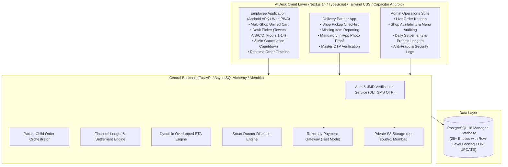

# AtDesk — Good things, delivered to your desk.
**A Product of The Sorted Club**  
*Initial Launch Location: JMD Megapolis, Sector 48, Gurugram, Haryana, India*

AtDesk is a premium multi-vendor office food and essentials ordering and delivery platform tailored for commercial office complexes, starting with **JMD Megapolis, Sector 48, Gurugram**.

Employees order from multiple nearby concourse shops in **one unified order**, pay AtDesk once with **one flat delivery fee (₹25)**, and AtDesk coordinates shop preparation, runner pickup, and **direct-to-desk delivery** via its own dedicated workforce.

**There is NO vendor application**: The entire ecosystem is centrally controlled through the **Admin Operations Command Center** and the **Delivery Partner Application**.

---

## Brand Identity & Design Tokens

- **Parent Company**: The Sorted Club (alongside VANVAS & Hagrid's Hut)
- **Tagline**: *"Good things, delivered to your desk."*
- **Aesthetic**: Modern Urban Convenience (Plus Jakarta Sans for Headings, Inter for Body & Tabular Numerals)

| Design Token | Hex Code | Purpose |
| :--- | :--- | :--- |
| **Forest Green** | `#103D32` | Primary brand identity, navigation accents, primary buttons |
| **Warm Ivory** | `#F7F4EC` | Primary application background, tactile comfort |
| **Soft Sage** | `#DDE9D9` | Secondary surfaces, category chips, pill tags |
| **Tangerine** | `#E9A16D` | Accent highlights, countdown warnings, status indicators |
| **Charcoal** | `#282B29` | High-contrast typography, dark borders |

---

## System Architecture



---

## Core Feature Implementations

### 1. Multi-Shop Cart & Single Flat Fee
- Add items from multiple shops (e.g., Kulhad Chai from **Chaayos**, Chicken Sub from **Subway**, Chole Bhature from **Haldiram's**, and Type-C Cable from **Megapolis Essentials**).
- Items are grouped shop-by-shop with individual subtotals.
- **Exactly one flat delivery fee (₹25)** is charged for the entire order regardless of the number of shops.

### 2. Strict 2-Minute Cancellation Engine
- Employees receive a visual countdown timer upon order placement.
- Cancellation is **server-authoritative**: after exactly 120 seconds, customer cancellation is automatically disabled.
- Eligible cancellations trigger an **instant 100% refund** to the original payment method and reversal entries in vendor ledgers.

### 3. Dual Shop Settlement Models (No Vendor App)
- **Model A: Daily Settlement**: Aggregates fulfilled vendor orders, generates daily settlement statements, requires finance verification, records banking/UPI UTR reference, and marks settlement `PAID`.
- **Model B: Prepaid Balance**: Tracks advance shop deposits in an immutable ledger, atomically deducts payable per order (`SELECT ... FOR UPDATE`), triggers low-balance alerts (`< ₹1,500`), halts orders when balance is depleted, and restores balance on cancellation.

### 4. Desk Delivery Anti-Fraud Verification
- Delivery partners **cannot** manually complete deliveries without evidence.
- Requires **mandatory in-app camera capture** (direct viewfinder snapshot; gallery uploads blocked).
- Requires **mandatory 6-digit Master OTP** entered by the runner and verified server-side against the customer's order.
- Captures GPS coordinates at JMD Megapolis Sector 48 (`28.4162° N, 77.0425° E`).

### 5. Dynamic Overlapped ETA Engine
- Calculates ETA backwards from preparation times: does **not** simply sum individual prep times because shops prepare concurrently.
- Formula: `max(prep_times)` + multi-shop coordination buffer + concourse transit + building elevator transit (by Tower & Floor) + desk drop.

---

## Android Application (Capacitor Native Build)

AtDesk has been wrapped as a native Android application using Capacitor with deep link support (`atdesk://` and `https://atdesk.thesortedclub.com`), hardware camera integration, location permissions, and offline-resilient networking.

- **Package ID**: `com.thesortedclub.atdesk`
- **Application Name**: `AtDesk`
- **Target SDK**: Android 35 (Android 15)
- **Minimum SDK**: Android 24 (Android 7.0 Nougat)

### Built APK Artifacts

1. **Debug APK**:
   - **Path**: `frontend/android/app/build/outputs/apk/debug/app-debug.apk`
   - **Size**: `10,432,225 bytes` (~10.4 MB)
   - **SHA-256**: `54BC22FF3766B42F3C3200D0209033115E3C8883B2C1EED778720FF2FB164560`

2. **Release APK (Signed)**:
   - **Path**: `frontend/android/app/build/outputs/apk/release/app-release.apk`
   - **Size**: `8,591,790 bytes` (~8.59 MB)
   - **SHA-256**: `33F006809EA2FDC10F92C933762D01BC0C576EB820C2401FC824E4EBA82C4456`
   - **Signature Verification**: Scheme v2 (True), Scheme v3 (True)
   - **Keystore**: Generated outside repository at `C:\Users\user\Desktop\atdesk-release.keystore`

### APK Installation Instructions

Install either build onto an Android emulator or connected device via ADB:

```bash
# Verify connected devices
adb devices

# Install Debug APK
adb install -r frontend/android/app/build/outputs/apk/debug/app-debug.apk

# Or install Release-Signed APK
adb install -r frontend/android/app/build/outputs/apk/release/app-release.apk

# Launch AtDesk on device
adb shell monkey -p com.thesortedclub.atdesk -c android.intent.category.LAUNCHER 1
```

---

## Running the Application Locally

### Prerequisites
- Node.js v18+ and npm
- Python 3.10+
- PostgreSQL 14+ (Port 5433 configured for staging cluster)
- Android SDK (Optional, for Android APK builds)

### 1. Database Setup & Migrations
```bash
# Configure environment variables
cp .env.example .env

# Run database migrations and seed JMD Megapolis data
python -m backend.app.seed.seed_data
```

### 2. Central Backend (FastAPI)
```bash
# Navigate to backend directory
cd backend

# Install dependencies
pip install -r requirements.txt

# Start the FastAPI server
uvicorn backend.app.main:app --host 0.0.0.0 --port 8000 --reload
```
Interactive API documentation: `http://localhost:8000/docs`

### 3. Frontend Web PWA (Next.js)
```bash
# Navigate to frontend directory
cd frontend

# Install dependencies
npm install

# Start development server
npm run dev
```
Web application endpoints:
- **Employee App**: `http://localhost:3000`
- **Delivery Partner App**: `http://localhost:3000/delivery`
- **Admin Command Center**: `http://localhost:3000/admin`

---

## Running Automated Tests

A comprehensive test suite of 27 automated tests validates the entire business and financial logic:

```bash
# Run all backend tests
python -m pytest backend/tests/ -v
```

Verified test coverage across 27 tests:
1. `backend/tests/test_atdesk.py` (12 tests): Multi-shop cart math, single flat ₹25 delivery fee, parent-child order orchestration, server-authoritative 2-minute cancellation rule, prepaid balance exhaustion, mandatory delivery photo & OTP verification, Razorpay webhook HMAC idempotency, and admin audit logging.
2. `backend/tests/test_commercial_pilot_validation.py` (5 tests): Database schema persistence, test-mode payment transitions, unit economics computation, and operational failure interventions.
3. `backend/tests/test_live_integrations.py` (7 tests): Indian DLT SMS OTP lifecycle, lockout enforcement, Razorpay test mode payment verification, AWS S3 private evidence storage adapter, campus routing engine, and FCM push notifications.
4. `backend/tests/test_postgresql_concurrency.py` (3 tests): High-concurrency PostgreSQL row-level locking (`SELECT ... FOR UPDATE`), transaction rollback safety, and daily settlement ledger reconciliation.

---

## GitHub Repository Setup & Push Runbook

- **GitHub Account**: `AbhirajSingh25`
- **Repository Name**: `AtDesk`
- **Visibility**: `PRIVATE`

### One-Time Push Commands:
```bash
# Initialize and stage clean project files (strictly adhering to .gitignore)
git init
git add .

# Verify no secrets or binaries are staged
git status

# Commit
git commit -m "Initial release preparation: AtDesk by The Sorted Club"

# Configure branch and remote
git branch -M main
git remote add origin https://github.com/AbhirajSingh25/AtDesk.git

# Push to private GitHub repository
git push -u origin main
```
